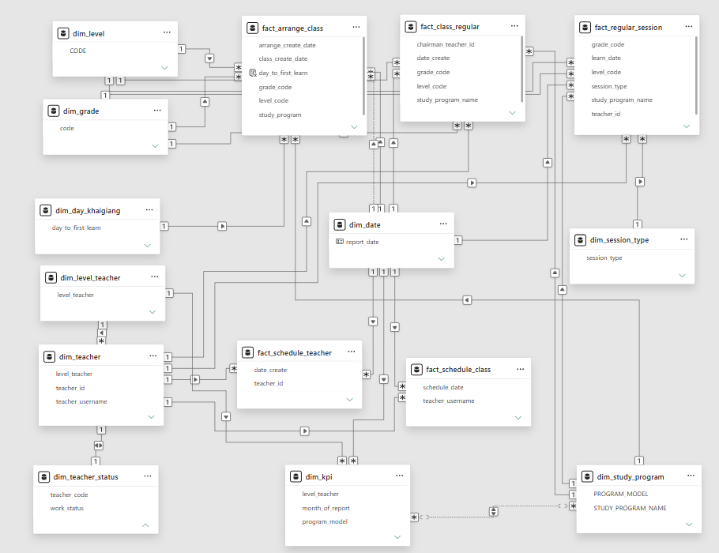
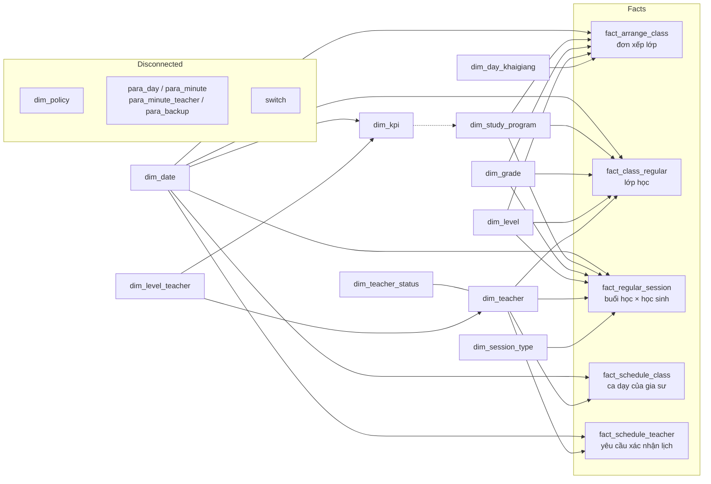
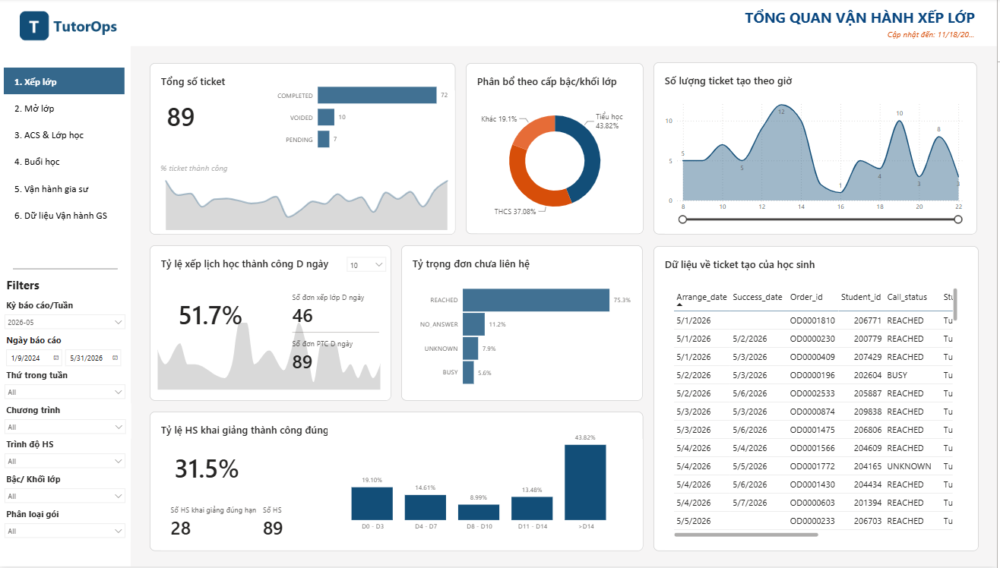
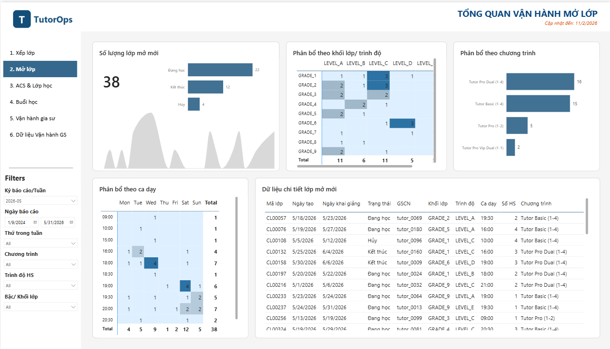
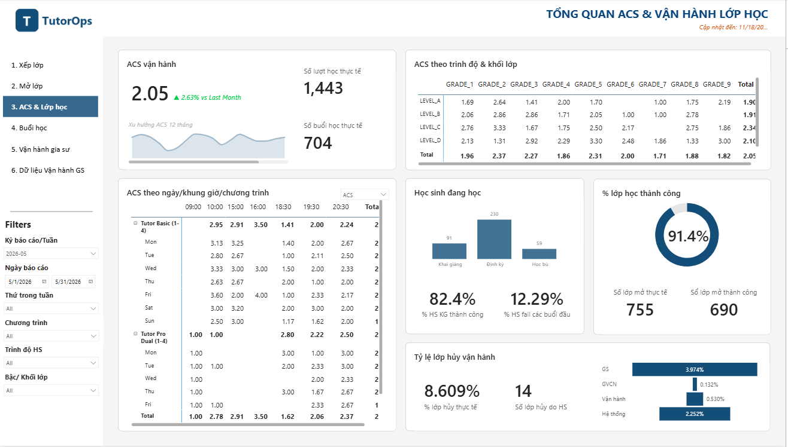
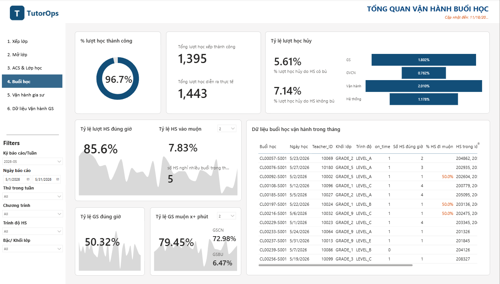
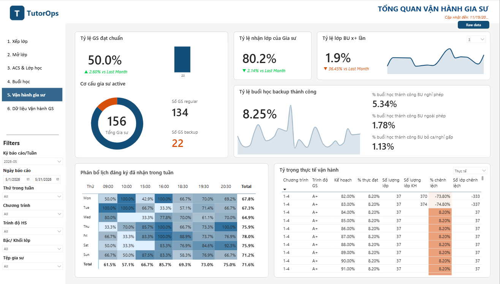

# Tutor Operations – Power BI

Báo cáo Power BI theo dõi vận hành lớp học gia sư online: xếp lớp, mở lớp, buổi học, lịch gia sư và chất lượng vận hành.

*Power BI report for the daily operations of an online small-group tutoring service.*


> Repo này là một case study về một báo cáo nội bộ: mô tả mô hình dữ liệu, các measure và các trang báo cáo. Các file `.pbip` / TMDL và dữ liệu không được công bố.
>
> Báo cáo đã được ẩn danh. Ảnh chụp màn hình dùng dữ liệu giả. Tên thương hiệu, nguồn dữ liệu, tên hệ thống nội bộ, tên người và số liệu thật đã được loại bỏ; chi tiết ở [docs/sanitization.md](docs/sanitization.md).

---

## 1. Mô hình dữ liệu

Mô hình gồm 5 bảng fact dùng chung một nhóm bảng dimension (star schema), một bảng chứa 134 measure (`A - Measure`; tổng 138, tính cả 4 measure của các bảng tham số) và một nhóm bảng không có quan hệ, dùng cho tham số, đổi chỉ số trên biểu đồ và ngưỡng vận hành.



*Model view trong Power BI Desktop. Các bảng không có quan hệ (`dim_policy`, `para_*`, `switch`) không xuất hiện trong ảnh, xem sơ đồ bên dưới.*

Sơ đồ rút gọn, mũi tên chỉ hướng lọc từ dimension sang fact:



### Grain của các bảng fact

| Fact | Một dòng là | Khóa | Cột ngày nối `dim_date` | Dimension liên quan |
|---|---|---|---|---|
| `fact_arrange_class` | một ticket xếp một học sinh vào một lớp | `task_arrange_class_id` | `arrange_create_date` (`class_create_date`: quan hệ inactive) | grade, level, study_program, day_khaigiang |
| `fact_class_regular` | một lớp học | `class_code` | `date_create` | grade, level, study_program, teacher (`chairman_teacher_id`) |
| `fact_regular_session` | một học sinh trong một buổi học | `class_session_code` + `student_id` | `learn_date` | grade, level, study_program, teacher, session_type |
| `fact_schedule_class` | một ca dạy gia sư đăng ký trong một ngày | `id` | `schedule_date` | teacher (`teacher_username`) |
| `fact_schedule_teacher` | một yêu cầu xác nhận lịch gửi cho gia sư | `id` | `date_create` | teacher (`teacher_id`) |

### Cách tổ chức mô hình

- `dim_date` nối với cả 5 fact và `dim_kpi`, `dim_teacher` nối với 4 fact, còn `dim_study_program`, `dim_grade`, `dim_level` nối với 3 fact. Vì vậy một slicer trên các bảng này lọc được nhiều fact cùng lúc.
- Các quan hệ lọc một chiều. Hai ngoại lệ là quan hệ 1:1 giữa `dim_teacher` và `dim_teacher_status`, và quan hệ many-to-many (inactive) tới `dim_kpi`.
- Mỗi fact có một quan hệ ngày active. Cột ngày thứ hai của `fact_arrange_class` (`class_create_date`) được nối bằng quan hệ inactive, nhưng hiện chưa measure nào dùng `USERELATIONSHIP` để bật nó. Các cột ngày khác vẫn dùng Auto date/time (xem [docs/optimization.md](docs/optimization.md)).
- `dim_kpi` có grain là tháng × mô hình lớp × cấp gia sư. Measure KPI lấy mục tiêu bằng `MAX(dim_kpi[KPI])` và dùng `REMOVEFILTERS(dim_level_teacher)` để tính tổng của cả mô hình lớp, làm mẫu số cho tỷ lệ thực đạt hoặc làm cơ sở nhân với KPI.
- 134 measure nằm trong bảng `A - Measure`, chia display folder theo từng mảng: xếp lớp, ACS, khai giảng, lượt học, lớp backup, đặt lịch gia sư, đổi chủ nhiệm, mở lớp. 4 measure còn lại nằm trong các bảng tham số `para_*`; tổng cộng 138.
- Các bảng tham số `para_day`, `para_minute`, `para_minute_teacher`, `para_backup` được tạo bằng `GENERATESERIES`; measure đọc giá trị qua `SELECTEDVALUE` có giá trị mặc định.
- Bảng `switch` (DATATABLE) kết hợp với một measure `SWITCH` và `formatStringDefinition`, cho phép đổi chỉ số trên cùng một biểu đồ, kèm định dạng số tương ứng.
- Trong bản ẩn danh, các ngưỡng vận hành (số ca tối thiểu, số ngày SLA, số phút trễ cho phép…) được tách khỏi DAX sang bảng `dim_policy` (giá trị minh họa). Đây là thay đổi làm khi chuẩn bị case study; model gốc viết ngưỡng trực tiếp trong DAX. Measure đọc ngưỡng bằng `LOOKUPVALUE` trong `CALCULATE(..., REMOVEFILTERS(dim_policy))` và lưu vào `VAR`.
- `dim_session_type`, `dim_day_khaigiang`, `dim_level_teacher` là các DATATABLE nhỏ, dùng cho nhãn hiển thị và thứ tự sắp xếp.

Tài liệu chi tiết:

- Bảng, khóa và quan hệ: [docs/data-model.md](docs/data-model.md)
- Một số measure tiêu biểu (7 measure) và số measure theo từng display folder: [docs/measures.md](docs/measures.md)

## 2. Bối cảnh

Dịch vụ tổ chức lớp nhỏ (1-1, 1-2, 1-4 học sinh) học theo lịch cố định hằng tuần. Đội vận hành theo dõi hằng ngày các câu hỏi:

- Đơn đăng ký mới có được xếp lớp trong số ngày mong muốn không?
- Lớp mới có khai giảng đúng hạn không? Bao nhiêu lớp bị hủy và vì lý do gì?
- Buổi học có diễn ra thành công không? Gia sư và học sinh có vào lớp đúng giờ không?
- Khi gia sư nghỉ, gia sư backup có thay được không?
- Gia sư có đăng ký đủ ca, đủ ca cao điểm và nhận lịch được giao không?

Trước đây số liệu được tổng hợp tay từ nhiều nguồn (LMS, CRM, Google Sheets). Báo cáo đưa các nguồn này về một mô hình dữ liệu, refresh tự động mỗi ngày.

## 3. Các trang báo cáo

| # | Trang | Nội dung | Chỉ số chính |
|---|---|---|---|
| 0 | Nghiệm thu | KPI vận hành so với mục tiêu | % đạt KPI theo mô hình lớp và cấp gia sư |
| 1 | Xếp lớp | Tốc độ xếp lớp cho đơn đăng ký | % xếp lớp trong D ngày, % đơn chưa liên hệ, số ticket theo giờ |
| 2 | Mở lớp | Lớp mở mới | Số lớp mở mới, phân bổ theo chương trình, khối lớp, ca dạy |
| 3 | ACS & Lớp học | Sĩ số trung bình và tình trạng lớp | ACS (Average Class Size), % lớp hủy, % lớp thành công, xu hướng 12 tháng |
| 4 | Buổi học | Chất lượng buổi học | % buổi học thành công, % HS/GS đúng giờ, % lượt học hủy |
| 5 | Vận hành gia sư | Nguồn cung gia sư | % GS đạt chuẩn đăng ký ca, % nhận lớp, % backup thành công |
| 6 | Dữ liệu vận hành GS | Bảng chi tiết để đối soát | Dữ liệu chi tiết lịch, buổi học, đổi chủ nhiệm |
| – | Tooltip (4 trang) | Chi tiết theo khối lớp, lượt hủy, lớp hủy, lịch | |

Ảnh chụp với dữ liệu giả:

| Xếp lớp | Mở lớp |
|---|---|
|  |  |
| **ACS & Lớp học** | **Buổi học** |
|  |  |
| **Vận hành gia sư** | |
|  | |

## 4. Một số kỹ thuật DAX

- **Tham số what-if** (`para_day`, `para_minute`, `para_backup`): người xem chọn ngưỡng như "xếp lớp trong D ngày", "muộn quá X phút", "backup từ X lần", measure tính lại theo giá trị được chọn.
- **Gia sư đạt chuẩn**: mỗi điều kiện được viết dưới dạng `FILTER(VALUES(teacher_id), CALCULATE(COUNT(...)) >= ngưỡng)` để giữ lại các gia sư thỏa điều kiện, sau đó đưa vào `CALCULATE` của measure đếm gia sư active. Trong bản ẩn danh, ngưỡng được đọc từ `dim_policy`.
- **Đổi chỉ số kèm định dạng động** (bảng `switch`): một biểu đồ chuyển giữa Buổi học, Lượt học và ACS bằng slicer; định dạng số đổi theo chỉ số.
- **So sánh với tháng trước**: các measure `vs Last Month` trả về nhãn có ký hiệu ▲ / ▼.

Mã DAX của các measure tiêu biểu: [docs/measures.md](docs/measures.md).

## 5. Tối ưu

Khi rà soát model, một số điểm có thể cải thiện về dung lượng, thời gian refresh và quan hệ: Auto date/time tạo 10 bảng ẩn, một calculated column dùng `RANKX` trên bảng fact, một số khóa quan hệ khác kiểu dữ liệu. Chi tiết và cách xử lý đề xuất ở [docs/optimization.md](docs/optimization.md).

## 6. Cấu trúc repo

```text
tutor-operations-powerbi-project/
├── README.md
├── docs/
│   ├── data-model.md
│   ├── measures.md                      # một số measure tiêu biểu
│   ├── optimization.md
│   └── sanitization.md
├── screenshots/                         # ảnh model view và các trang báo cáo
└── LICENSE
```

## 7. Công cụ

Power BI Desktop (PBIP / PBIR / TMDL) · DAX · Power Query (M) · SQL · Python

## Bản quyền

© 2026 Dương Nguyễn. Repo chỉ dùng để xem như một phần portfolio; không cho phép sao chép hoặc tái sử dụng nội dung. Xem [LICENSE](LICENSE).
