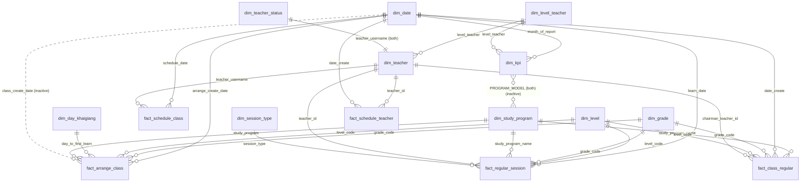

# Data model

> Trích từ định nghĩa TMDL của model (không công bố trong repo này).

## Relationship diagram

## Tables

| Table | Type | Columns | Calculated columns | Measures |
|---|---|---|---|---|
| `A - Measure` | Measure table | 0 | 0 | 134 |
| `dim_date` | Dimension | 8 | 5 | 0 |
| `dim_day_khaigiang` | Dimension | 2 | 0 | 0 |
| `dim_grade` | Dimension | 5 | 0 | 0 |
| `dim_kpi` | Dimension | 4 | 0 | 0 |
| `dim_level` | Dimension | 3 | 0 | 0 |
| `dim_level_teacher` | Dimension | 2 | 0 | 0 |
| `dim_policy` | Policy (disconnected) | 5 | 0 | 0 |
| `dim_session_type` | Dimension | 3 | 0 | 0 |
| `dim_study_program` | Dimension | 7 | 0 | 0 |
| `dim_teacher` | Dimension | 7 | 0 | 0 |
| `dim_teacher_status` | Dimension | 2 | 0 | 0 |
| `fact_arrange_class` | Fact | 24 | 2 | 0 |
| `fact_class_regular` | Fact | 20 | 0 | 0 |
| `fact_regular_session` | Fact | 22 | 3 | 0 |
| `fact_schedule_class` | Fact | 19 | 2 | 0 |
| `fact_schedule_teacher` | Fact | 7 | 0 | 0 |
| `para_backup` | Parameter | 1 | 0 | 1 |
| `para_day` | Parameter | 1 | 0 | 1 |
| `para_minute` | Parameter | 1 | 0 | 1 |
| `para_minute_teacher` | Parameter | 1 | 0 | 1 |
| `switch` | Helper (đổi chỉ số) | 4 | 0 | 0 |

Bảng trên không liệt kê các bảng phụ dùng khi phát triển (`tab`, `Table`, `dim_tag_student`).

## Các bảng fact: khóa và cột chính

Không liệt kê đầy đủ cột; chỉ nêu khóa, cột dùng cho quan hệ và một vài cột trạng thái chính.

| Fact | Khóa | Cột quan hệ | Cột trạng thái / đo lường chính |
|---|---|---|---|
| `fact_arrange_class` | `task_arrange_class_id` | `arrange_create_date`, `class_create_date` (inactive), `grade_code`, `level_code`, `study_program`, `day_to_first_learn` | `arrange_status`, `arrange_type`, `ptc_date`, `arrange_success_date` |
| `fact_class_regular` | `class_code` | `date_create`, `grade_code`, `level_code`, `study_program_name`, `chairman_teacher_id` | `class_status`, `number_of_students`, `class_openning_date` |
| `fact_regular_session` | `class_session_code` + `student_id` | `learn_date`, `grade_code`, `level_code`, `study_program_name`, `teacher_id`, `session_type` | `session_status`, `student_status`, `is_student_on_time`, `is_backup` |
| `fact_schedule_class` | `id` | `schedule_date`, `teacher_username` | `schedule_status`, `is_schedule_required`, `evening_shift`, `peak_shift` |
| `fact_schedule_teacher` | `id` | `date_create`, `teacher_id` | `status`, `teacher_status` |

## Relationships

| From | To | Cardinality | Cross filter | Active |
|---|---|---|---|---|
| `fact_regular_session.learn_date` | `dim_date.report_date` | many:one | single | yes |
| `fact_arrange_class.arrange_create_date` | `dim_date.report_date` | many:one | single | yes |
| `fact_arrange_class.grade_code` | `dim_grade.code` | many:one | single | yes |
| `fact_arrange_class.level_code` | `dim_level.CODE` | many:one | single | yes |
| `fact_schedule_class.schedule_date` | `dim_date.report_date` | many:one | single | yes |
| `fact_arrange_class.day_to_first_learn` | `dim_day_khaigiang.day_to_first_learn` | many:one | single | yes |
| `fact_arrange_class.study_program` | `dim_study_program.STUDY_PROGRAM_NAME` | many:one | single | yes |
| `fact_arrange_class.class_create_date` | `dim_date.report_date` | many:one | single | no |
| `fact_regular_session.level_code` | `dim_level.CODE` | many:one | single | yes |
| `fact_regular_session.grade_code` | `dim_grade.code` | many:one | single | yes |
| `fact_regular_session.study_program_name` | `dim_study_program.STUDY_PROGRAM_NAME` | many:one | single | yes |
| `fact_schedule_class.teacher_username` | `dim_teacher.teacher_username` | many:one | single | yes |
| `fact_regular_session.teacher_id` | `dim_teacher.teacher_id` | many:one | single | yes |
| `fact_regular_session.session_type` | `dim_session_type.session_type` | many:one | single | yes |
| `fact_class_regular.study_program_name` | `dim_study_program.STUDY_PROGRAM_NAME` | many:one | single | yes |
| `fact_class_regular.date_create` | `dim_date.report_date` | many:one | single | yes |
| `fact_class_regular.grade_code` | `dim_grade.code` | many:one | single | yes |
| `fact_class_regular.level_code` | `dim_level.CODE` | many:one | single | yes |
| `fact_class_regular.chairman_teacher_id` | `dim_teacher.teacher_id` | many:one | single | yes |
| `dim_study_program.PROGRAM_MODEL` | `dim_kpi.program_model` | many:many | both | no |
| `dim_kpi.month_of_report` | `dim_date.report_date` | many:one | single | yes |
| `dim_teacher.level_teacher` | `dim_level_teacher.level_teacher` | many:one | single | yes |
| `dim_kpi.level_teacher` | `dim_level_teacher.level_teacher` | many:one | single | yes |
| `dim_teacher.teacher_username` | `dim_teacher_status.teacher_code` | one:one | both | yes |
| `fact_schedule_teacher.teacher_id` | `dim_teacher.teacher_id` | many:one | single | yes |
| `fact_schedule_teacher.date_create` | `dim_date.report_date` | many:one | single | yes |
